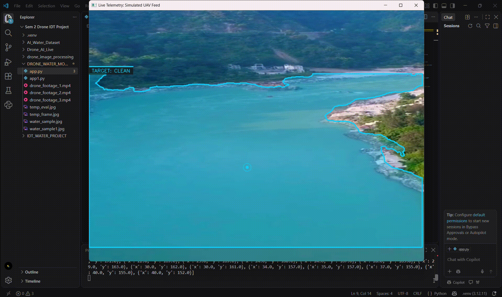

# Drone-Assisted Surface Water Quality Classification Using Image Processing

*Watch the [full video demonstration here](https://youtu.be/-bIXHAMKm60).*

## Overview
This project is a drone-assisted environmental monitoring system that automates surface water quality classification using real-time computer vision. It solves the inefficiency and high cost of traditional manual water sampling by deploying a UAV to instantly identify visible aquatic conditions such as Algae, Turbidity, or Solid Debris pollution. The system operates by capturing live aerial video feeds and utilizing an asynchronous, multithreaded edge-to-cloud architecture to run complex YOLOv26 instance segmentation without exceeding the drone's onboard hardware limits.

## Hardware Components (BOM)
*  Quadcopter Frame & Propellers
*  Brushless DC Motors (4 Nos.) & Electronic Speed Controllers (ESCs)
*  Flight Controller & Li-Po Battery
*  Optical Camera Module & Local Onboard Computing Unit
  
## Circuit & Physical Build

*Virtual CATIA CAD model of the quadcopter chassis, engineered to support a 1.6kg payload while achieving a >2:1 thrust-to-weight ratio for stable optical tracking.*   

## Software & Libraries
*   **Language:** Python
*   **Libraries:** cv2 (OpenCV), numpy, inference_sdk (Roboflow HTTP Client)

## How It Works
1. The UAV captures live aerial video telemetry, and the Python application's daemon thread extracts one frame every 15 frames to prevent network bottlenecking.
2. The frame is resized to 800x600 and transmitted asynchronously to a serverless API hosting a YOLOv26 Nano instance segmentation model.
3. The AI maps the organic shoreline contours of the detected water class (Clean, Turbid, Algae, Polluted) and returns a JSON payload of complex polygon coordinates.
4. The local OpenCV interface scales the polygon coordinates to the 1024x768 HUD size and utilizes Image Moments (cv2.moments) to mathematically calculate the centroid (Centre of Mass) of the water anomaly.
5. The system renders smooth, anti-aliased bounding polygons and dynamic targeting data plates over the live video, relying on "Target Memory" hysteresis logic to prevent UI flickering while awaiting the next cloud inference.
